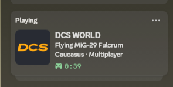

# DCS World Rich Presence for Discord ✈️

Unofficial Windows utility displaying your **aircraft**, **terrain**, **single-player/multiplayer** status and **session timer** in Discord.

**Windows 10/11 x64 · DCS World · Discord Desktop**

## Download / Télécharger

1. Open the repository's **Releases** page and download **`DCS-Rich-Presence-Setup-v1.0.0.exe`**.
2. Exit DCS World. Install as your normal Windows user; admin rights and Python are **not required**.
3. Launch **DCS World Rich Presence** from the Start menu, choose your DCS **Saved Games** folder (e.g. `%USERPROFILE%\Saved Games\DCS`, **not** the Steam installation), and click **Install & Start**.
4. Open Discord Desktop, then DCS. Your presence appears automatically while DCS is running.
5. Optional: tick **Start silently with Windows** so no console needs to stay open.

**Français :** télécharge l'installateur dans *Releases*, ferme DCS, installe le programme, sélectionne le dossier `Parties enregistrées\DCS` dans l'interface puis clique **Install & Start**. Le démarrage avec Windows est facultatif.

## Details

- DCS WORLD activity with the `dcs_logo` HD Discord Application Asset and application icon
- 12 automatic display languages: English, French, German, Spanish, Italian, Portuguese, Russian, Arabic, Japanese, Korean, Simplified Chinese, Traditional Chinese
- DCS Saved Games `Scripts/Hooks/NeiloRichPresence.lua` hook; does not change `Export.lua`, `MissionScripting.lua`, or game files
- Discord desktop IPC via [pypresence](https://github.com/qwertyquerty/pypresence); no token required
- Activity is cleared when DCS closes (normally within 15 seconds)
- No automated updates or telemetry
- **Shared Discord Application ID:** `1566882349633765446`; Discord application metadata & `dcs_logo` asset must remain available for all users. They are managed by the application's owner, not by this installer.

## Privacy

The software reads only a small DCS hook JSON file under the user's Saved Games and Windows process list; it sends aircraft/map/mode/timestamp to the local Discord desktop IPC. Discord handles the resulting public presence. No mission coordinates, server IPs, account passwords, or tokens are read or transmitted by this utility. Local logs are kept in `%LOCALAPPDATA%\DCSRichPresence` for troubleshooting.

## Diagnostics and fixes

- **Presence not showing:** enable game activity in Discord, keep Discord Desktop running, check `%LOCALAPPDATA%\DCSRichPresence\presence.log` and `startup-error.log`.
- **Wrong map or aircraft:** module/server may not expose slot data; check `Saved Games\DCS\Logs\NeiloRichPresence.json`.
- **Logo blurry or missing:** the owner of the shared Discord application must upload 512px `assets/dcs_logo_512.png` under Discord Developer Portal → Rich Presence → Art Assets, key `dcs_logo`, and set the application's icon in General Information. Other users do not need their own Developer Portal app.
- **Older zip version still running:** disable its autostart, stop it, then launch v1.0.0 (the installer removes the old precisely named startup shortcut after setup).
- **Windows SmartScreen:** the executable is unsigned in this source release. Validate it with the release SHA-256 and review the source; do not disable security tools globally.
- **Manual language override:** edit `%LOCALAPPDATA%\DCSRichPresence\config.json`, set `"language": "fr"` (or other supported tag), then stop and restart from the Start menu.

## Uninstall

Use **Windows Settings → Apps → Installed apps → DCS World Rich Presence → Uninstall**. The installer stops the app, removes its Windows autostart entry and its **unmodified** DCS hook, without affecting other hooks. If the hook has been edited, it is left untouched as a precaution. Old `.bak` files are also preserved. Close DCS before uninstalling.

## Building from source (Windows)

Install Python 3.12 and [Inno Setup 6](https://jrsoftware.org/isinfo.php), then run PowerShell `./build-windows.ps1`. This tests the core, builds a PyInstaller *onedir* binary (includes its own Python runtime), then makes a normal Inno Setup installer in `release/`.

To create a public GitHub repository from the source, install Git for Windows and the GitHub CLI, run `gh auth login`, then execute `./publish-github.ps1` in PowerShell. The script asks you to explicitly confirm publication.

On GitHub, `.github/workflows/windows-release.yml` runs on Windows. Use **Actions → Windows installer → Run workflow** for a downloadable build artifact; pushing a `v1.0.0` tag also creates a Release and publishes the installer + SHA-256 manifest.

## Credits and licensing

Original integration code: Neilo Community, MIT. DCS World is a trademark of Eagle Dynamics SA; the DCS logo is third-party artwork **not** part of the MIT grant. Not affiliated with or endorsed by Eagle Dynamics, Discord, or Valve.
